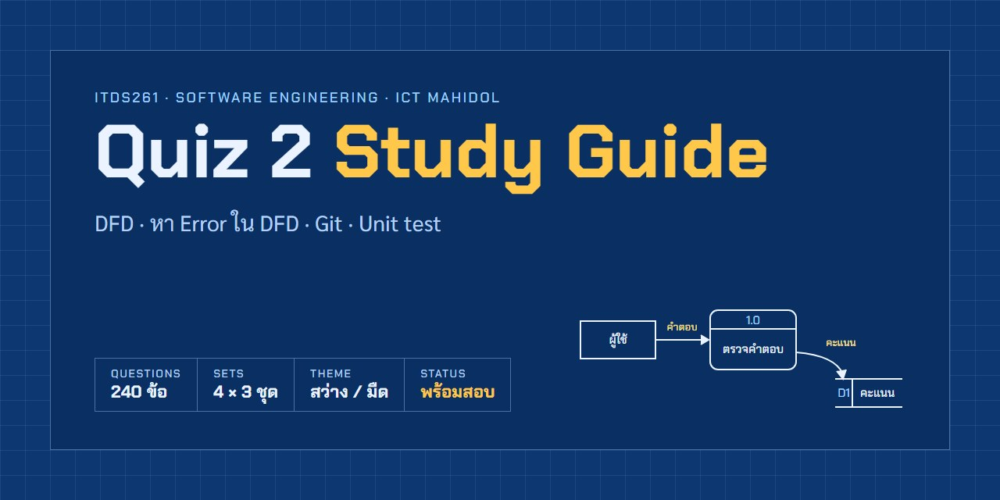
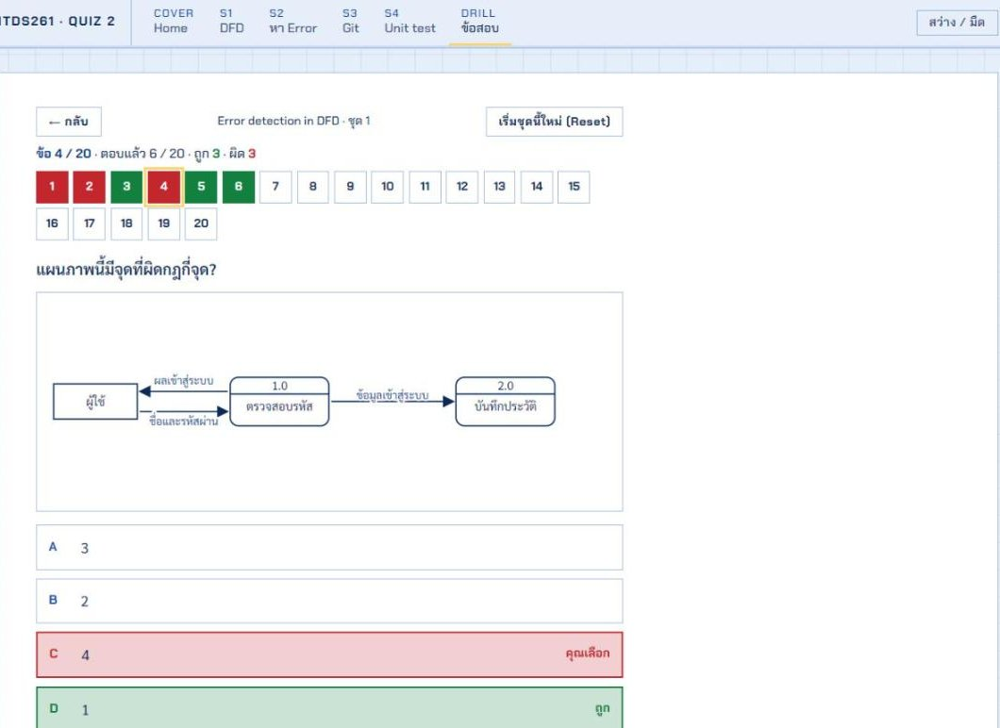

<a href="https://thinnaphat-tht.github.io/itds261-quiz2-guide/"></a>

<p align="center">
  <a href="https://thinnaphat-tht.github.io/itds261-quiz2-guide/"></a>
  <a href="https://thinnaphat-tht.github.io/itds261-quiz2-guide/ITDS261-Quiz2-Guide.html#quiz"></a>
</p>

<p align="center">
  
  
  
</p>

เว็บติวสอบ Quiz 2 วิชา ITDS261 Software Engineering (ICT มหิดล) ครอบคลุม 4 หัวข้อที่ประกาศสอบ: **DFD Understanding**, **Error detection in DFD**, **Git functions** และ **Unit test** พร้อมข้อสอบฝึก 240 ข้อ

**เปิดเว็บ: https://thinnaphat-tht.github.io/itds261-quiz2-guide/**

| ลิงก์ตรงแต่ละหน้า | |
|---|---|
| [S1 · DFD: นิยามและกฎ](https://thinnaphat-tht.github.io/itds261-quiz2-guide/ITDS261-Quiz2-Guide.html#dfd) | [S2 · หา Error ใน DFD](https://thinnaphat-tht.github.io/itds261-quiz2-guide/ITDS261-Quiz2-Guide.html#err) |
| [S3 · Git functions](https://thinnaphat-tht.github.io/itds261-quiz2-guide/ITDS261-Quiz2-Guide.html#git) | [S4 · Unit test + JUnit](https://thinnaphat-tht.github.io/itds261-quiz2-guide/ITDS261-Quiz2-Guide.html#unit) |
| [DRILL · ข้อสอบ 240 ข้อ](https://thinnaphat-tht.github.io/itds261-quiz2-guide/ITDS261-Quiz2-Guide.html#quiz) | |


## มีอะไรบ้าง

- **แผนอ่านตามวัน** บนหน้าแรก นับถอยหลังถึงวันสอบ และติ๊กได้ว่าอ่านหัวข้อไหนจบแล้ว
- **สรุป 4 หัวข้อ** แยกหน้ากัน (S1–S4) ยึดนิยามและกฎตามสไลด์อาจารย์ แนบรูปสไลด์จริงพร้อมเลขหน้า กดขยายดูได้
- **เกมหาจุดผิดใน DFD** จากสไลด์ L6 หน้า 42 คลิกหรือใช้คีย์บอร์ดเลือกจุดที่ผิดกฎ
- **ข้อสอบ 4 หัวข้อ × 3 ชุด × 20 ข้อ** เฉลยทันทีทีละข้อ ถูกเป็นสีเขียว ผิดเป็นสีแดง บอกเหตุผลและหน้าสไลด์ที่อ้างอิง
  - แผนภาพ DFD ในข้อสอบวาดด้วย SVG จากข้อมูล และตรวจกฎด้วยโค้ด
  - มีแถบความคืบหน้า ปุ่มเริ่มใหม่ ทำเฉพาะข้อที่พลาด และจำคะแนนสูงสุดของแต่ละชุด
- **ธีมสว่าง/มืด** สลับได้ด้วยปุ่มมุมขวาบน



## วิธีเปิด

**เปิดออนไลน์:** https://thinnaphat-tht.github.io/itds261-quiz2-guide/

หรือดาวน์โหลด repo แล้วเปิด `ITDS261-Quiz2-Guide.html` ในเบราว์เซอร์ได้เลย ไม่ต้องติดตั้งอะไร และใช้งานแบบออฟไลน์ได้ (ฟอนต์อยู่ในโฟลเดอร์ `fonts/`)

ถ้าอยากเปิดผ่าน local server:

```bash
python -m http.server 8765
# แล้วเปิด http://localhost:8765/ITDS261-Quiz2-Guide.html
```

ใช้คีย์บอร์ดได้ทั้งเว็บ: ลูกศรซ้าย/ขวาเปลี่ยนหน้า, ในข้อสอบกด A–D หรือ 1–4 เพื่อตอบ และ Enter ไปข้อถัดไป

## โครงสร้างไฟล์

| ไฟล์ | หน้าที่ |
|---|---|
| `ITDS261-Quiz2-Guide.html` | หน้าเว็บทั้งหมด (สรุป 4 หัวข้อ, หน้าแรก, หน้าข้อสอบ) |
| `quiz.js` | ตัวรันข้อสอบ, ตัววาด DFD และตัวตรวจกฎ DFD |
| `quiz-data.js` | ข้อสอบ 240 ข้อ (ตัวเลือกแรกในข้อมูลคือคำตอบที่ถูก แล้วสลับตอนแสดง) |
| `img/` | รูปสไลด์ที่ใช้ประกอบ |
| `fonts/` | Chakra Petch และ Sarabun แบบ self-hosted |
| `DESIGN.md`, `PRODUCT.md` | ระบบดีไซน์ "The Drawing Set" (แนว blueprint) และหลักของโปรเจกต์ |

## หมายเหตุ

- ข้อสอบทั้งหมด**แต่งขึ้นเองจากกฎในสไลด์** ไม่ใช่ข้อสอบจริงของอาจารย์
- รูปสไลด์ใน `img/` เป็นของผู้สอนรายวิชา ใช้เพื่อการทบทวนเท่านั้น
