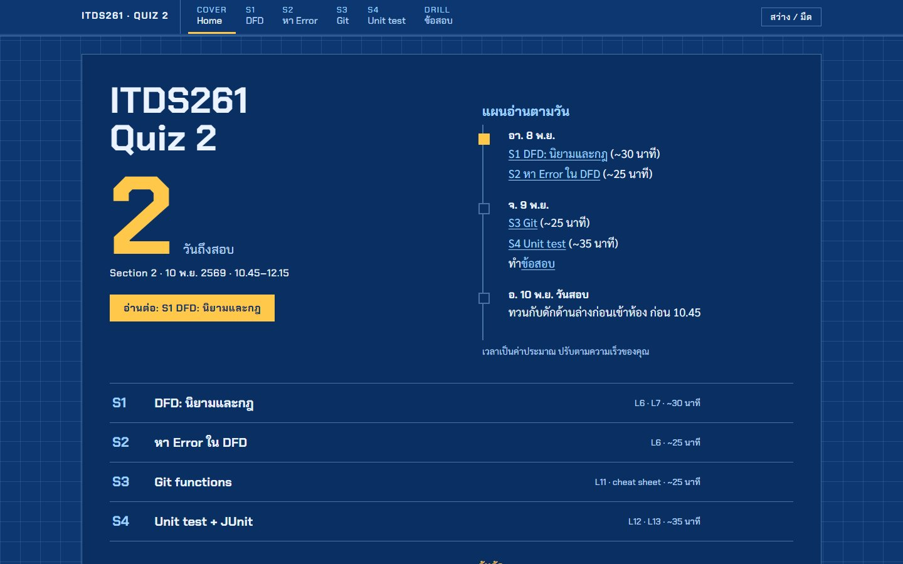

  
  
  

เว็บติว Quiz 2 วิชา ITDS261 Software Engineering (ICT มหิดล) ครบ 4 หัวข้อที่ประกาศสอบ พร้อมข้อสอบฝึก 228 ข้อ

| หัวข้อ | เนื้อหา |
|:--|:--|
| [S1 · DFD](https://thinnaphat-tht.github.io/ITDS261-Quiz2-Guide/ITDS261-Quiz2-Guide.html#dfd) | นิยามและกฎ Process / Data Store / Data Flow |
| [S2 · หา Error ใน DFD](https://thinnaphat-tht.github.io/ITDS261-Quiz2-Guide/ITDS261-Quiz2-Guide.html#err) | จุดผิดกฎที่ชอบออก |
| [S3 · Git](https://thinnaphat-tht.github.io/ITDS261-Quiz2-Guide/ITDS261-Quiz2-Guide.html#git) | คำสั่งและการทำงานของ Git |
| [S4 · Unit test](https://thinnaphat-tht.github.io/ITDS261-Quiz2-Guide/ITDS261-Quiz2-Guide.html#unit) | JUnit, ECP/BVA, Flow chart, V(G) |
| [ข้อสอบ](https://thinnaphat-tht.github.io/ITDS261-Quiz2-Guide/ITDS261-Quiz2-Guide.html#quiz) | 4 หัวข้อ × 3 ชุด + ข้อสอบรวม 40 ข้อ |

- เฉลยทันทีทีละข้อ บอกเหตุผลและหน้าสไลด์ที่อ้างอิง
- ทำเฉพาะข้อที่พลาดได้ จำคะแนนสูงสุดของแต่ละชุด
- สลับธีมสว่าง/มืดได้ ใช้ออฟไลน์ได้ (ดาวน์โหลดแล้วเปิด `ITDS261-Quiz2-Guide.html`)

> ข้อสอบทั้งหมดแต่งขึ้นจากกฎในสไลด์ ไม่ใช่ข้อสอบจริง
> เจอเฉลยผิด? [แจ้งตรงนี้](https://github.com/Thinnaphat-tht/ITDS261-Quiz2-Guide/issues/new/choose)

ทำโดย Thinnaphat · Mahidol ICT DST

